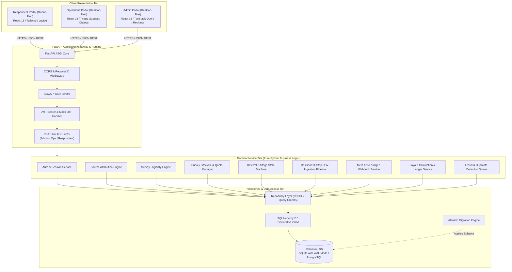

# ViewBox Club — System Architecture Specification
**Concave Insights — Technical Assessment: Full Stack Developer (Python/React)**

---

## 1. Executive Architecture Overview

The ViewBox Panel System is designed as a **Modular Monolith** optimized for developer ergonomics, zero-friction local execution, and production readiness. It cleanly decouples user interface layers, business domain services, and persistence abstractions while avoiding the latency, complex deployment orchestration, and operational overhead of distributed microservices.



---

## 2. Client Presentation Tier Architecture

The frontend is implemented as a single, unified React 18 single-page application (SPA) structured with distinct sub-applications partitioned by layout and authentication guards:

### 2.1 Dual-Viewport UX Philosophy
1. **Respondent Portal (`/portal`):**
   - Designed exclusively with a **mobile-first layout constraint** ($360\text{px} - 430\text{px}$ viewport width).
   - Touch-optimized tap targets ($\ge 44\text{px}$), sticky bottom navigation bar, card-based survey listings, and simplified modal dialogs.
   - Designed for high-stress, low-bandwidth mobile network conditions common to end consumers across tier-1 and tier-2 Indian cities.
2. **Operations & Admin Portals (`/ops`, `/admin`):**
   - Designed for **desktop-first high information density** ($1280\text{px}+$ viewport).
   - Persistent collapsible navigation sidebar, multi-column sortable data grids, debounced instant search, contextual filter sidebars, and tabbed workflow queues.

### 2.2 Client State & Network Architecture
- **Server Cache & Synchronization:** TanStack Query v5 manages all remote data fetching, mutation synchronization, background refetching on window focus, and cache invalidation.
- **Form Management:** React Hook Form coupled with Zod schema validation provides instant inline client validation mirroring backend Pydantic constraints.
- **Routing & Route Guards:** React Router v6 provides nested route layouts with `RequireAuth` and `RequireRole` higher-order components to enforce client-side navigation security.

---

## 3. API Gateway & Security Architecture

### 3.1 Security Flow & Mock OTP Authentication
The platform provides a passwordless authentication mechanism engineered specifically for high-conversion consumer onboarding without external third-party SMS vendor costs:

```mermaid
sequenceDiagram
    autonumber
    actor Respondent
    participant Client as React Client (Mobile)
    participant API as FastAPI /auth/otp
    participant DB as Relational Database

    Respondent->>Client: Enters 10-digit mobile number
    Client->>API: POST /api/v1/auth/otp/send { phone }
    API->>DB: Check or create User; Generate 6-digit cryptosecure OTP
    Note over API: In DEV/DEMO mode, OTP is logged & returned in debug response
    API-->>Client: 200 OK { message, dev_otp: "123456" }
    Client->>Respondent: Displays mock OTP on screen
    Respondent->>Client: Enters OTP & submits
    Client->>API: POST /api/v1/auth/otp/verify { phone, otp }
    API->>DB: Verify OTP & check expiry (5 minutes)
    API-->>Client: 200 OK { access_token (JWT), refresh_token, role, profile_completed }
    Client->>Client: Store JWT in secure storage; redirect to Onboarding or Dashboard
```

### 3.2 Role-Based Access Control (RBAC)
Role validation is enforced at the HTTP router layer using FastAPI's dependency injection system:
- `get_current_active_user`: Validates JWT signature, checks expiration, and retrieves user from database.
- `require_role([RoleEnum.ADMIN])`: Rejects any user lacking the required role with an immediate HTTP 403 Forbidden.
- **Resource Ownership Guards:** For respondent profile operations, the authenticated user's `id` is compared against the target resource's `user_id`. Any attempt to modify another member's profile returns an immediate HTTP 403 Forbidden.

---

## 4. Domain Service Architecture

### 4.1 Survey Eligibility Engine
The eligibility engine evaluates candidate suitability deterministically:
- **Zero Frontend Duplication:** The React UI never calculates eligibility. It queries the backend API (`GET /surveys/{id}/eligibility` or bulk `GET /surveys/feed`) which returns `{ status: "APPROVED" | "WAITLISTED" | "REJECTED", reasons: string[], next_eligible_date: string | null }`.
- **Precedence Hierarchy:**
  $$\text{REJECTED} \succ \text{WAITLISTED} \succ \text{APPROVED}$$
  1. *Hard Checks:* Survey status must be `ACTIVE`; current timestamp $\le$ deadline; quota not exhausted; respondent not in 3-month cool-off. Failing any hard check results in immediate `REJECTED`.
  2. *Attribute Checks:* Age, City, Gender, Income, Interests.
     - Strict rule failure $\rightarrow$ `REJECTED`.
     - Flexible rule failure $\rightarrow$ `WAITLISTED` (if not already rejected).
     - All rules satisfied $\rightarrow$ `APPROVED`.

### 4.2 Source Attribution Engine
- **Attribution Tokenization:** Unique 16-character alphanumeric tokens generated via `secrets.token_urlsafe(12)`.
- **First-Touch Preservation:** If a user already possesses an active attribution cookie or session, existing first-touch acquisition source is preserved, while secondary touches are logged in `AttributionEvent`.
- **Orthogonal Referral Storage:** When a user registers via an acquisition source (e.g., Instagram) but provides a valid member referral code, both the channel attribution and the peer referral relationship are recorded in distinct database entities.

### 4.3 Resilient CSV Ingestion Pipeline
- Engineered with an 11-step preview-and-commit architecture.
- Reads uploaded file in streaming chunks.
- Isolates row parsing so that malformed rows, impossible dates (e.g. Feb 31), or duplicate records populate an error registry without crashing the import process.
- Commits valid records inside a single atomic database transaction (`db.commit()`), rolling back cleanly upon unhandled database-level failures.

### 4.4 Meta Ads Lead Integration
- Exposes `POST /api/v1/integrations/meta/leads`.
- Implements a normalized mock payload matching official Meta Lead Ads webhook delivery specifications.
- Implements strict idempotency using a unique database constraint on `leadgen_id`.
- Automatically assigns acquisition source to `Meta Ads` while capturing campaign, form, and ad metadata in `meta_leads`.

---

## 5. Persistence & Database Architecture

### 5.1 Dual-Database Strategy (SQLite + PostgreSQL)
- **Local Development & Assessment Evaluation:** SQLite 3 is utilized for instant, zero-dependency local startup.
  - WAL (Write-Ahead Logging) mode is activated (`PRAGMA journal_mode=WAL;`) to permit concurrent readers alongside writers.
  - Foreign key constraints explicitly enforced (`PRAGMA foreign_keys=ON;`).
  - Busy timeout configured to 10,000ms to eliminate locking contention during tests.
- **Production Readiness:** The SQLAlchemy declarative schema utilizes database-agnostic data types (standard String, Integer, DateTime with UTC timezone, Text, and Boolean) ensuring 100% drop-in compatibility with PostgreSQL.

### 5.2 Transaction Management & Concurrency
- All database write operations utilize explicit session context managers:
  ```python
  async with session.begin():
      # atomic transactional block
      ...
  ```
- Survey quota updates enforce concurrency safety using atomic conditional updates:
  ```sql
  UPDATE surveys
  SET completed_count = completed_count + 1
  WHERE id = :survey_id AND completed_count < target_quota;
  ```
  If the affected row count is 0, the transaction aborts and informs the applicant that the quota was filled by a concurrent user.

---

## 6. Audit Logging & System Transparency

Every administrative or operational mutation is permanently logged in the `audit_logs` table:
- Action Types: `SURVEY_CREATED`, `SURVEY_UPDATED`, `REFERRAL_FIT_APPROVED`, `REFERRAL_COMPLETED`, `REFERRAL_FAILED`, `PAYOUT_APPROVED`, `CSV_IMPORTED`, `SOURCE_CREATED`.
- Metadata captures actor user ID, entity name, entity ID, previous state (JSON), new state (JSON), client IP address, and timestamp.
