# ViewBox Club — Relational Database Schema Specification
**Concave Insights — Technical Assessment: Full Stack Developer (Python/React)**

---

## 1. Schema Design Rationale & Normalization

The database architecture is designed in strict Third Normal Form (3NF) to eliminate data redundancy, protect demographic and operational history, and enforce business constraints at the database engine level.

### Key Architectural Decisions:
1. **Decoupling User Authentication from Member Demographics:** A `users` record represents an authenticated identity (phone number, role, session security), while `member_profiles` encapsulates market research demographics (city, date of birth, income bracket, interests). This enables future multi-profile capabilities and cleanly isolates security logic from consumer attributes.
2. **Dynamic Acquisition Sources:** Acquisition channels are represented as dynamic rows in `acquisition_sources` rather than hardcoded enums. Administrators can provision new channels (e.g., "WhatsApp Group - Nagpur", "Instagram Influencer Campaign 03") on demand.
3. **Decoupled Referral Relationships:** The `referrals` table links a referring member to a referred member with lifecycle stage tracking (`LEAD`, `FIT`, `COMPLETED`, `FAILED`). Self-referrals are prevented via check constraints.
4. **Structured Multi-Attribute Eligibility Rules:** Rather than storing un-indexed JSON blobs, `survey_eligibility_rules` models criteria as discrete relational rows with strict foreign keys to surveys and strict/flexible categorization.
5. **Two-Stage Payout Ledger:** `payouts` acts as an auditable ledger for both survey participation fees and referral bonuses, requiring explicit operational sign-off before funds are disbursed.

---

## 2. Complete Entity-Relationship (ER) Diagram

```mermaid
erDiagram
    users ||--o| member_profiles : "owns profile"
    users ||--o{ audit_logs : "triggers"
    users ||--o{ surveys : "admin creates"
    users ||--o{ payouts : "ops approves"

    acquisition_sources ||--o{ source_links : "has trackable links"
    acquisition_sources ||--o{ attribution_events : "receives traffic"
    acquisition_sources ||--o{ member_profiles : "originates"

    source_links ||--o{ attribution_events : "generates clicks"

    member_profiles ||--o{ referrals : "refers (as referrer)"
    member_profiles ||--o{ referrals : "referred (as candidate)"
    member_profiles ||--o{ survey_applications : "applies to"
    member_profiles ||--o{ survey_participations : "completes"
    member_profiles ||--o{ payouts : "receives"
    member_profiles ||--o{ fraud_flags : "flagged in"
    member_profiles ||--o| meta_leads : "created from"

    surveys ||--o{ survey_eligibility_rules : "governed by"
    surveys ||--o{ survey_applications : "receives"
    surveys ||--o{ survey_participations : "records"
    surveys ||--o{ payouts : "generates incentives"

    import_jobs ||--o{ import_row_errors : "logs row errors"

    users {
        string id PK
        string phone UK
        string role "ADMIN | OPERATIONS | RESPONDENT"
        boolean is_active
        datetime created_at
        datetime updated_at
    }

    member_profiles {
        string id PK
        string member_id UK "e.g. VB10073"
        string user_id FK
        string full_name
        string phone UK
        string email
        string gender "Male | Female | Other"
        date date_of_birth
        string city
        string income_range "Below 3L | 3L-6L | 6L-10L | 10L-20L | Above 20L"
        string interests "Semicolon-delimited"
        string acquisition_source_id FK
        date joined_on
        date last_survey_completed_on
        datetime created_at
        datetime updated_at
    }

    acquisition_sources {
        string id PK
        string name UK "e.g. WhatsApp Group - Mumbai"
        string channel_type "WHATSAPP | STAFF | INSTAGRAM | FACEBOOK | WEBSITE | META_ADS | REFERRAL | OTHER"
        string code UK
        boolean is_active
        datetime created_at
    }

    source_links {
        string id PK
        string source_id FK
        string token UK "Cryptographically secure token"
        string target_url
        integer click_count
        datetime created_at
    }

    attribution_events {
        string id PK
        string source_id FK
        string source_link_id FK
        string ip_address
        string user_agent
        datetime created_at
    }

    referrals {
        string id PK
        string referrer_member_id FK
        string referred_member_id FK
        string referral_token
        string stage "LEAD | FIT | COMPLETED | FAILED"
        string failure_reason
        datetime fit_verified_at
        datetime completion_verified_at
        datetime created_at
        datetime updated_at
    }

    surveys {
        string id PK
        string title
        string description
        date start_date
        date deadline "max start_date + 15 days"
        string status "DRAFT | ACTIVE | QUOTA_REACHED | EXPIRED | CLOSED"
        integer target_quota
        integer completed_count
        numeric incentive_amount
        numeric referral_bonus_amount
        string created_by_user_id FK
        datetime created_at
        datetime updated_at
    }

    survey_eligibility_rules {
        string id PK
        string survey_id FK
        string rule_type "AGE_MIN | AGE_MAX | CITY | GENDER | INCOME_RANGE | INTEREST"
        string rule_value "e.g. 18, Mumbai, Female, Tech"
        string strictness "STRICT | FLEXIBLE"
        datetime created_at
    }

    survey_applications {
        string id PK
        string survey_id FK
        string member_id FK
        string status "APPLIED | APPROVED | WAITLISTED | REJECTED"
        string eligibility_reasons "JSON or Text"
        datetime applied_at
    }

    survey_participations {
        string id PK
        string survey_id FK
        string member_id FK
        string status "COMPLETED | REJECTED"
        datetime completed_at
        string verified_by_user_id FK
        datetime verified_at
    }

    payouts {
        string id PK
        string member_id FK
        string survey_id FK
        string referral_id FK
        string payout_type "SURVEY_COMPLETION | REFERRAL_BONUS"
        numeric amount
        string status "PENDING_APPROVAL | APPROVED | PROCESSING | PAID | FAILED"
        string approved_by_user_id FK
        datetime approved_at
        string payment_reference
        string failure_reason
        datetime created_at
        datetime updated_at
    }

    fraud_flags {
        string id PK
        string member_id FK
        string flag_type "DUPLICATE_PHONE | SELF_REFERRAL | REFERRAL_RING | VELOCITY_BURST"
        string status "PENDING_REVIEW | CONFIRMED_FRAUD | DISMISSED"
        string details
        string reviewed_by_user_id FK
        datetime reviewed_at
        datetime created_at
    }

    meta_leads {
        string id PK
        string leadgen_id UK "Meta Graph API Lead ID"
        string form_id
        string campaign_id
        string ad_id
        string member_id FK
        string raw_payload "JSON"
        datetime lead_created_time
        datetime received_at
    }

    import_jobs {
        string id PK
        string file_name
        integer total_rows
        integer valid_rows
        integer imported_rows
        integer skipped_rows
        integer error_count
        string status "PENDING | IN_PROGRESS | COMPLETED | FAILED"
        string created_by_user_id FK
        datetime created_at
        datetime completed_at
    }

    import_row_errors {
        string id PK
        string job_id FK
        integer row_number
        string raw_member_id
        string raw_phone
        string error_column
        string error_reason
        string raw_data "JSON"
        datetime created_at
    }

    audit_logs {
        string id PK
        string user_id FK
        string action "e.g. REFERRAL_STAGE_UPDATE"
        string entity_name
        string entity_id
        string previous_state "JSON"
        string new_state "JSON"
        string ip_address
        datetime created_at
    }
```

---

## 3. Data Dictionary & Detailed Entity Specifications

### 3.1 Entity: `users`
Represents an authenticated system identity.
| Column | Type | Constraints | Description |
|:---|:---|:---|:---|
| `id` | `VARCHAR(36)` | PK | UUID v4 primary key |
| `phone` | `VARCHAR(15)` | UNIQUE, NOT NULL | Normalized 10-digit Indian phone (`9876543210`) |
| `hashed_otp` | `VARCHAR(255)` | NULLABLE | Salted hash of active OTP |
| `otp_expires_at` | `DATETIME` | NULLABLE | Expiry timestamp for mock OTP (5-minute TTL) |
| `role` | `VARCHAR(20)` | NOT NULL, DEFAULT 'RESPONDENT' | `ADMIN`, `OPERATIONS`, `RESPONDENT` |
| `is_active` | `BOOLEAN` | NOT NULL, DEFAULT TRUE | Soft-delete / account suspension flag |
| `created_at` | `DATETIME` | NOT NULL, DEFAULT UTC_NOW | Account creation timestamp |
| `updated_at` | `DATETIME` | NOT NULL, DEFAULT UTC_NOW | Last profile update timestamp |

### 3.2 Entity: `member_profiles`
Encapsulates consumer demographics and research panel data.
| Column | Type | Constraints | Description |
|:---|:---|:---|:---|
| `id` | `VARCHAR(36)` | PK | UUID v4 primary key |
| `member_id` | `VARCHAR(20)` | UNIQUE, NOT NULL | Business ID (e.g., `VB10073`) |
| `user_id` | `VARCHAR(36)` | FK(`users.id`), UNIQUE, NOT NULL | Linked authentication identity |
| `full_name` | `VARCHAR(100)` | NOT NULL | Respondent full name |
| `phone` | `VARCHAR(15)` | UNIQUE, NOT NULL | Normalized phone number |
| `email` | `VARCHAR(100)` | NULLABLE | Validated email address |
| `gender` | `VARCHAR(20)` | NOT NULL | Canonical: `Male`, `Female`, `Other` |
| `date_of_birth` | `DATE` | NOT NULL | Date of birth for age calculation |
| `city` | `VARCHAR(50)` | NOT NULL | Canonical city (e.g. `Mumbai`, `Pune`) |
| `income_range` | `VARCHAR(50)` | NOT NULL | Bracket: `Below 3L`, `3L-6L`, `6L-10L`, `10L-20L`, `Above 20L` |
| `interests` | `TEXT` | NOT NULL | Semicolon-delimited categories (e.g. `Tech;Travel;Auto`) |
| `acquisition_source_id` | `VARCHAR(36)` | FK(`acquisition_sources.id`) | Initial attribution source |
| `joined_on` | `DATE` | NOT NULL, DEFAULT UTC_DATE | Member registration date |
| `last_survey_completed_on` | `DATE` | NULLABLE | Most recent verified survey completion date |
| `created_at` | `DATETIME` | NOT NULL, DEFAULT UTC_NOW | Record creation timestamp |
| `updated_at` | `DATETIME` | NOT NULL, DEFAULT UTC_NOW | Last record modification timestamp |

### 3.3 Entity: `acquisition_sources`
Dynamic marketing and recruitment channels.
| Column | Type | Constraints | Description |
|:---|:---|:---|:---|
| `id` | `VARCHAR(36)` | PK | UUID v4 |
| `name` | `VARCHAR(100)` | UNIQUE, NOT NULL | Display name (e.g., `WhatsApp Group - Pune`) |
| `channel_type` | `VARCHAR(30)` | NOT NULL | Category: `WHATSAPP`, `STAFF`, `INSTAGRAM`, `FACEBOOK`, `WEBSITE`, `META_ADS`, `REFERRAL`, `OTHER` |
| `code` | `VARCHAR(50)` | UNIQUE, NOT NULL | Alphanumeric slug identifier |
| `is_active` | `BOOLEAN` | NOT NULL, DEFAULT TRUE | Channel active flag |
| `created_at` | `DATETIME` | NOT NULL, DEFAULT UTC_NOW | Creation timestamp |

### 3.4 Entity: `referrals`
Peer-to-peer referral state machine.
| Column | Type | Constraints | Description |
|:---|:---|:---|:---|
| `id` | `VARCHAR(36)` | PK | UUID v4 |
| `referrer_member_id` | `VARCHAR(36)` | FK(`member_profiles.id`), NOT NULL | Member who shared referral link |
| `referred_member_id` | `VARCHAR(36)` | FK(`member_profiles.id`), UNIQUE, NOT NULL | New member who registered |
| `referral_token` | `VARCHAR(64)` | NOT NULL | Cryptographic token embedded in share link |
| `stage` | `VARCHAR(20)` | NOT NULL, DEFAULT 'LEAD' | State machine: `LEAD`, `FIT`, `COMPLETED`, `FAILED` |
| `failure_reason` | `TEXT` | NULLABLE | Required explanation when marked `FAILED` |
| `fit_verified_at` | `DATETIME` | NULLABLE | Timestamp when operations marked as `FIT` |
| `completion_verified_at` | `DATETIME` | NULLABLE | Timestamp when operations marked as `COMPLETED` |
| `created_at` | `DATETIME` | NOT NULL, DEFAULT UTC_NOW | Timestamp of signup via referral |
| `updated_at` | `DATETIME` | NOT NULL, DEFAULT UTC_NOW | Timestamp of last stage update |

*Integrity Check:* `CHECK (referrer_member_id <> referred_member_id)` strictly prohibits self-referral.

### 3.5 Entity: `surveys`
Survey projects with strict 15-day lifecycle and quota limits.
| Column | Type | Constraints | Description |
|:---|:---|:---|:---|
| `id` | `VARCHAR(36)` | PK | UUID v4 |
| `title` | `VARCHAR(200)` | NOT NULL | Study title (e.g., `EV Two-Wheeler Adoption Survey`) |
| `description` | `TEXT` | NOT NULL | Overview and respondent instructions |
| `start_date` | `DATE` | NOT NULL | Project launch date |
| `deadline` | `DATE` | NOT NULL | Project completion deadline |
| `status` | `VARCHAR(20)` | NOT NULL, DEFAULT 'ACTIVE' | `DRAFT`, `ACTIVE`, `QUOTA_REACHED`, `EXPIRED`, `CLOSED` |
| `target_quota` | `INTEGER` | NOT NULL, CHECK > 0 | Target number of complete participations |
| `completed_count` | `INTEGER` | NOT NULL, DEFAULT 0 | Real-time verified completions |
| `incentive_amount` | `NUMERIC(10,2)` | NOT NULL, DEFAULT 250.00 | Participation reward (INR) |
| `referral_bonus_amount` | `NUMERIC(10,2)` | NOT NULL, DEFAULT 100.00 | Bonus paid to referrer on verified completion |
| `created_by_user_id` | `VARCHAR(36)` | FK(`users.id`), NOT NULL | Administrator who launched survey |
| `created_at` | `DATETIME` | NOT NULL, DEFAULT UTC_NOW | Record creation timestamp |
| `updated_at` | `DATETIME` | NOT NULL, DEFAULT UTC_NOW | Record update timestamp |

*Integrity Check:* `CHECK (deadline <= date(start_date, '+15 days'))` strictly enforces the 15-day maximum project lifecycle.

### 3.6 Entity: `survey_eligibility_rules`
Multi-attribute eligibility parameters.
| Column | Type | Constraints | Description |
|:---|:---|:---|:---|
| `id` | `VARCHAR(36)` | PK | UUID v4 |
| `survey_id` | `VARCHAR(36)` | FK(`surveys.id`), NOT NULL | Target survey |
| `rule_type` | `VARCHAR(30)` | NOT NULL | `AGE_MIN`, `AGE_MAX`, `CITY`, `GENDER`, `INCOME_RANGE`, `INTEREST` |
| `rule_value` | `VARCHAR(100)` | NOT NULL | Parameter value (e.g., `18`, `35`, `Mumbai`, `Tech`) |
| `strictness` | `VARCHAR(10)` | NOT NULL, DEFAULT 'STRICT' | `STRICT` (Fail $\rightarrow$ Reject) or `FLEXIBLE` (Fail $\rightarrow$ Waitlist) |
| `created_at` | `DATETIME` | NOT NULL, DEFAULT UTC_NOW | Creation timestamp |

### 3.7 Entity: `payouts`
Ledger of owed rewards.
| Column | Type | Constraints | Description |
|:---|:---|:---|:---|
| `id` | `VARCHAR(36)` | PK | UUID v4 |
| `member_id` | `VARCHAR(36)` | FK(`member_profiles.id`), NOT NULL | Payee member |
| `survey_id` | `VARCHAR(36)` | FK(`surveys.id`), NULLABLE | Associated survey project |
| `referral_id` | `VARCHAR(36)` | FK(`referrals.id`), NULLABLE | Associated referral relationship |
| `payout_type` | `VARCHAR(30)` | NOT NULL | `SURVEY_COMPLETION` or `REFERRAL_BONUS` |
| `amount` | `NUMERIC(10,2)` | NOT NULL | Payout value (INR) |
| `status` | `VARCHAR(20)` | NOT NULL, DEFAULT 'PENDING_APPROVAL' | `PENDING_APPROVAL`, `APPROVED`, `PROCESSING`, `PAID`, `FAILED` |
| `approved_by_user_id` | `VARCHAR(36)` | FK(`users.id`), NULLABLE | Operations user sign-off |
| `approved_at` | `DATETIME` | NULLABLE | Operations approval timestamp |
| `payment_reference` | `VARCHAR(100)` | NULLABLE | Bank UTR or payment gateway transaction ID |
| `failure_reason` | `TEXT` | NULLABLE | Bank decline or operational rejection reason |
| `created_at` | `DATETIME` | NOT NULL, DEFAULT UTC_NOW | Ledger entry creation timestamp |
| `updated_at` | `DATETIME` | NOT NULL, DEFAULT UTC_NOW | Last ledger status update |

### 3.8 Entity: `audit_logs`
System-wide immutable audit trail.
| Column | Type | Constraints | Description |
|:---|:---|:---|:---|
| `id` | `VARCHAR(36)` | PK | UUID v4 |
| `user_id` | `VARCHAR(36)` | FK(`users.id`), NULLABLE | Actor who performed mutation |
| `action` | `VARCHAR(50)` | NOT NULL | Action identifier (e.g. `REFERRAL_FIT_APPROVED`) |
| `entity_name` | `VARCHAR(50)` | NOT NULL | Target table name (e.g. `referrals`) |
| `entity_id` | `VARCHAR(36)` | NOT NULL | Target record primary key |
| `previous_state` | `TEXT` | NULLABLE | JSON snapshot before mutation |
| `new_state` | `TEXT` | NULLABLE | JSON snapshot after mutation |
| `ip_address` | `VARCHAR(45)` | NULLABLE | Client IPv4 / IPv6 address |
| `created_at` | `DATETIME` | NOT NULL, DEFAULT UTC_NOW | Event timestamp |
