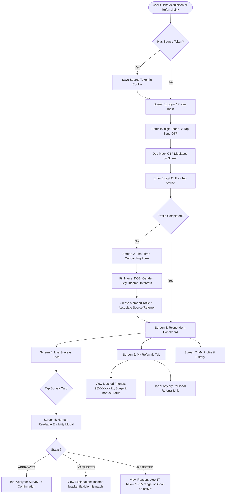
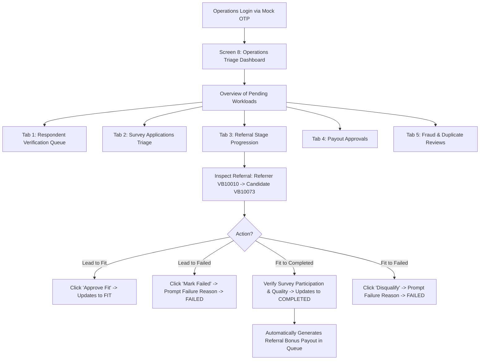
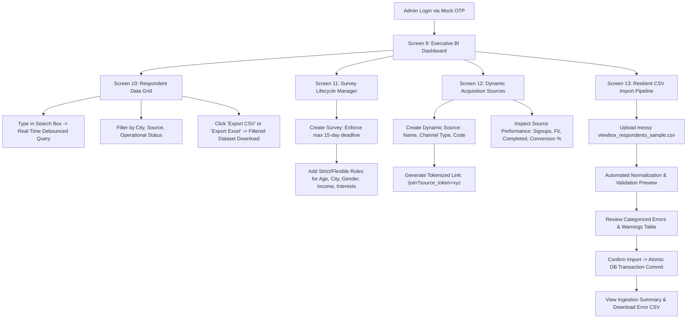

# ViewBox Club — User Flow & Interface Specifications
**Concave Insights — Technical Assessment: Full Stack Developer (Python/React)**

---

## 1. User Journey Architecture

The ViewBox Panel System serves three distinct user personas across mobile and desktop interfaces:
1. **Respondent (Consumer):** Mobile-first experience focused on friction-free onboarding, transparent survey access, clear eligibility explanations, and masked referral tracking.
2. **Operations Specialist:** Desktop workflow optimized for triage speed, candidate suitability verification, quality audits, and payout review.
3. **Administrator:** Desktop mission-control dashboard for executive business intelligence, real-time data grid filtering, dynamic acquisition channel management, survey rule creation, and resilient data imports.

---

## 2. Respondent Journey (Mobile-First Experience)

### 2.1 Detailed Screen Specifications — Respondent Portal

#### Screen 1: Mobile Login (`/login`)
- **Visual Design:** Clean, centered card on neutral slate background with ViewBox Club branding.
- **Controls:**
  - 10-digit mobile number input with Indian phone prefix (`+91`).
  - "Get Verification Code" button with loading state.
  - Development Helper Banner: In development/demo mode, a dismissible badge displays: *"Development Mode: Your verification code is `123456`"*.
  - 6-digit OTP input grid with auto-focus.
  - "Verify & Continue" button.

#### Screen 2: First-Time Onboarding (`/onboarding`)
- **Header:** "Welcome to ViewBox Club! Let's set up your profile."
- **Fields:**
  - Full Name (text input).
  - Date of Birth (native date picker with validation requiring $\ge 13$ years old).
  - Gender (pill radio buttons: Male, Female, Other).
  - City (searchable dropdown: Mumbai, Pune, Nagpur, Ahmedabad, Hyderabad, Bengaluru, etc.).
  - Income Range (selector: Below 3L, 3L-6L, 6L-10L, 10L-20L, Above 20L).
  - Interests (multi-select chips: Tech, Travel, Auto, Fashion, Food, Beauty, Health, Finance, Kids, Home).
  - Organic Fallback: If no attribution token was detected in cookie/storage, displays: *"How did you hear about us?"* with dynamic source options.
- **Submission:** Submits payload to `POST /api/v1/members/onboarding`.

#### Screen 3 & 4: Respondent Dashboard & Survey Listing (`/portal/surveys`)
- **Top Bar:** Welcome greeting with member's first name, current earnings badge, and quick referral link copy icon.
- **Cool-off Alert (Conditional):** If the respondent completed a survey within the last 3 months, an informational alert appears:
  > **3-Month Cool-off Active:** You are in a cool-off window until **15-Jan-2027** to ensure research diversity. You can still refer friends and earn referral bonuses!
- **Survey Cards:** Card list with:
  - Title & Category Badge (e.g. "Automotive Research", "Fashion Trends").
  - Reward Pill (e.g. "₹250 Participation Fee").
  - Deadline countdown ("Ends in 6 days").
  - Match Indicator ("Matches your interests: Auto, Tech").
  - Live Status Pill:
    - `APPROVED` (Emerald Green): "You Qualify".
    - `WAITLISTED` (Amber): "Waitlisted".
    - `REJECTED` (Muted Rose): "Not Eligible".

#### Screen 5: Eligibility Details Modal
- Triggered by tapping any survey card.
- Displays plain-language explanation of each criterion:
  - Age Criteria: *"Met: Age 26 is within 18–35."*
  - City Criteria: *"Met: Mumbai is a target research market."*
  - Gender Criteria: *"Met: Survey targets all genders."*
  - Income Criteria: *"Waitlisted: Target bracket is 10L-20L. Your profile is 6L-10L."*
- Action: "Submit Application" button active only if status is `APPROVED`.

#### Screen 6: My Referrals (`/portal/referrals`)
- **Header Summary:** Total Invited, Pending Verification, Completed Surveys, Total Bonuses Earned.
- **Share Card:** Personal referral link with 1-tap copy button and native WhatsApp Share trigger.
- **Referred Friends List:** Table/Cards showing:
  - Masked Mobile: `98XXXXXX21` (full numbers strictly masked).
  - Registration Date.
  - Three-Stage Progress Bar: `Lead` $\rightarrow$ `Fit` $\rightarrow$ `Completed`.
  - Failure Notice: If marked `Failed`, shows friendly notice (e.g., *"Did not meet survey demographic requirements"*).
  - Incentive Status: *"₹100 Bonus Earned"* or *"Pending Survey Completion"*.

---

## 3. Operations Specialist Journey (Desktop Queue Experience)

### 3.1 Detailed Screen Specifications — Operations Portal

#### Screen 8: Operations Triage Dashboard (`/ops`)
- **Metric Banners:**
  - Pending Respondent Fit Reviews.
  - Survey Applications Pending Approval.
  - Pending Referral Completions.
  - Payout Requests Awaiting Authorization.
- **Referral Verification Queue:**
  - Filterable by referrer ID, candidate city, and current stage.
  - Row Actions:
    - **Mark Fit:** Single-click approval moving candidate from `LEAD` to `FIT`.
    - **Mark Failed:** Opens a required modal with predefined and custom failure reasons (*"Outside target geography"*, *"Failed profile verification"*, *"Duplicate household"*).
    - **Confirm Completion:** Enabled only when the candidate has an associated completed `SurveyParticipation` record. Transitions state to `COMPLETED` and initiates referral bonus payout record.

---

## 4. Administrator Journey (Desktop Mission Control)

### 4.1 Detailed Screen Specifications — Admin Panel

#### Screen 9: Executive BI Dashboard (`/admin`)
- **KPI Metrics Cards:** Total Respondents, 7-Day New Signups, Live Survey Projects, Active Referrals, Total Paid Rewards.
- **Interactive Visualizations (Recharts):**
  - **Signup Acquisition Trend:** Area chart showing daily signups by source.
  - **Channel Breakdown:** Donut chart showing share of acquisition (WhatsApp vs Instagram vs Staff DMs vs Referrals).
  - **Referral Conversion Funnel:** Funnel showing transition drop-offs from `Lead` $\rightarrow$ `Fit` $\rightarrow$ `Completed`.
  - **Survey Status Distribution:** Horizontal bar chart showing target vs completed quotas.

#### Screen 10: Respondent Data Grid (`/admin/respondents`)
- **Live Search Bar:** Real-time debounced search (300ms) matching name, member ID, phone, or city.
- **Multi-Select Filters:** City (multi-select), Acquisition Source (multi-select), Operational Status.
- **Data Table:** Member ID, Full Name, Phone, Email, City, Gender, Income, Source, Joined Date, Actions (View Profile Drawer).
- **Export Toolbar:** "Export CSV" and "Export Excel (.xlsx)" buttons triggering immediate streaming downloads of the **currently filtered** recordset.

#### Screen 11: Survey Creator & Rule Configurator (`/admin/surveys/new`)
- **Lifecycle Guard:** Date pickers for Start Date and Deadline. Enforces rule:
  $$\text{Deadline} \le \text{Start Date} + 15\text{ days}$$
  Selecting a date beyond 15 days disables form submission with error banner: *"Survey lifecycle cannot exceed 15 days"*.
- **Rule Builder:** Dynamically add rules:
  - Age Range: Min age (default 18), Max age (default 65), Strict/Flexible toggle.
  - Cities: Multi-select target cities, Strict/Flexible toggle.
  - Genders: Multi-select target genders, Strict/Flexible toggle.
  - Income Brackets: Multi-select target brackets, Strict/Flexible toggle.
  - Interests: Multi-select required interests, Strict/Flexible toggle.

#### Screen 12: Dynamic Source Management (`/admin/sources`)
- **Source Creator:** Name (e.g. "WhatsApp Group - Ahmedabad"), Channel Type (WhatsApp, Staff, Instagram, Meta Ads, etc.).
- **Link Generator:** Generates shareable URL with cryptographically random token (`/join?source_token=src_...`).
- **Channel Performance Analytics:** Real-time aggregated table showing:
  - Total Signups.
  - Verified Fit Count.
  - Completed Survey Count.
  - Conversion Rate ($(\text{Completed} / \text{Signups}) \times 100$).

#### Screen 13: Resilient CSV Import Pipeline (`/admin/import`)
- **File Dropzone:** Accepts `.csv` up to 10MB.
- **Parsing & Normalization Preview:**
  - Displays summary counters: Total Rows (189), Valid Rows, Duplicate Rows, Rows with Critical Errors.
  - Shows normalization log (e.g. *"Normalized 32 city aliases: Bombay -> Mumbai, Bangalore -> Bengaluru"*).
- **Interactive Errors & Fixes Table:**
  - Shows row number, member ID, phone, column name, raw value, error reason (e.g., Row 15: `31/02/1995` - Invalid Calendar Date; Row 48: Self-Referral Discarded).
- **Two-Step Commit:** "Commit Valid Records" button triggers atomic database transaction. Provides "Download Import Error Report (CSV)" for unimportable rows.
