# ViewBox Panel System — Principal Software Architect Review & Technical Evaluation
**Concave Insights Technical Assessment | Evaluation Date: 2026-11-24**
**Reviewer:** Principal Software Architect & Technical Lead

---

## 1. Executive Architectural Audit

A rigorous architectural evaluation of the proposed ViewBox Panel System was conducted against the Concave Insights assessment requirements, business constraints, sample CSV realities, and the seven-day delivery deadline.

### Overall Architecture Verdict: **APPROVED WITH REFINEMENTS**
The modular monolith architecture using FastAPI, SQLAlchemy 2.0, SQLite/PostgreSQL, and React 18 is sound and well-tailored for this domain. However, a deeper analysis reveals specific **relational gaps, business-rule ambiguities, security vulnerabilities, and deadline risks** that must be resolved prior to full backend implementation.

This document details the architectural critique, identifies exact failure modes, and codifies the definitive refinements incorporated into the finalized Day 2 design deliverables.

---

## 2. Identified Issues & Corrective Architecture

### 2.1 Missing Entities & Relationship Gaps

#### Gap 1: Survey Participation Mechanism (`survey_url` & Application-to-Participation Transition)
- **The Issue:** The initial schema recorded `survey_applications` and `survey_participations`, but lacked the mechanism by which approved respondents actually complete the survey. Market research studies at Concave Insights are often hosted on custom external survey engines, Typeform, or Google Forms.
- **Architectural Solution:**
  1. Add `surveys.survey_url` (`VARCHAR(500)`): Stores the questionnaire URL (external or internal).
  2. Clarify the lifecycle:
     $$\text{Survey Feed} \xrightarrow{\text{Eligibility: Approved}} \text{Application (APPLIED)} \xrightarrow{\text{Ops/Auto Approval}} \text{Assigned (APPROVED)} \xrightarrow{\text{Respondent Takes Survey}} \text{Participation Submitted} \xrightarrow{\text{Ops Quality Verification}} \text{Verified (COMPLETED)}$$
  3. When Ops marks a `SurveyParticipation` as `COMPLETED`:
     - `surveys.completed_count` increments atomically.
     - A pending `payouts` entry is generated for the respondent (Participation Fee, e.g. ₹250).
     - If the member was referred by another user, the linked `referrals` stage transitions to `COMPLETED`, triggering a referral bonus payout (e.g. ₹100) for the referrer.
     - The member's `last_survey_completed_on` timestamp is updated, starting the 3-month cool-off clock.

#### Gap 2: Survey Quotas Granularity (`survey_quotas` vs `surveys.target_quota`)
- **The Issue:** The assessment entity list mentions `survey_quotas`. A single integer quota on `surveys` does not allow quota slicing by city or gender (e.g., 50 spots in Mumbai, 50 in Pune).
- **Architectural Solution:**
  - Maintain `surveys.target_quota` as the overall project cap for simplicity and fast indexing.
  - Implement an optional relational `survey_quotas` table supporting demographic bucket quotas (`quota_type`: `CITY`, `GENDER`, `TOTAL`; `target_count`, `completed_count`). If no specific sub-quotas are defined, the survey defaults to `surveys.target_quota`. This satisfies the entity requirement without overcomplicating simple surveys.

#### Gap 3: Payout Mutex Integrity Constraint
- **The Issue:** In the initial schema, `payouts.survey_id` and `payouts.referral_id` were both nullable without an explicit mutual exclusivity constraint. This created a potential integrity bug where an orphaned payout has neither, or an invalid payout references both.
- **Architectural Solution:**
  - Enforce a database check constraint:
    ```sql
    CHECK (
      (payout_type = 'SURVEY_COMPLETION' AND survey_id IS NOT NULL AND referral_id IS NULL) OR
      (payout_type = 'REFERRAL_BONUS' AND referral_id IS NOT NULL AND survey_id IS NULL)
    )
    ```

#### Gap 4: Meta Lead Ingestion & Login Onboarding Lifecycle
- **The Issue:** When a Meta Lead Ads webhook delivers a lead (`POST /api/v1/integrations/meta/leads`), how does that lead become an authenticated member without duplicate profile collisions?
- **Architectural Solution:**
  1. Webhook persists the raw lead in `meta_leads` (`leadgen_id` has a `UNIQUE` constraint for idempotency).
  2. The system checks if a `users` record exists for the normalized phone:
     - *If user does NOT exist:* Creates a `User` (Role: `RESPONDENT`, `is_active: True`) and an associated `MemberProfile` with data pre-filled from Meta fields (`full_name`, `phone`, `city`), assigning `acquisition_source_id` to dynamic source `Meta Ads`.
     - *If user DOES exist:* Flags the incoming lead in `meta_leads` as `DUPLICATE_PHONE_LEAD` for ops review, preventing accidental overwrite of existing member profiles.
  3. When the consumer subsequently visits the portal and logs in with their phone + mock OTP, their profile is already pre-populated, requiring only confirmation.

---

### 2.2 Business-Rule Conflicts & Ambiguities Resolved

#### Conflict 1: Quota Enforcement Timing (Applications vs Completions)
- **Problem:** If a survey has a quota of 50, does it stop accepting *applications* at 50, or does it close when 50 respondents *complete* the survey?
- **Resolution:** In market research operations, drop-off occurs between application and verified completion (typical survey drop-off is 20-30%).
  - The survey has two thresholds:
    1. `target_quota` (Target verified completions).
    2. `max_applications` (Buffer cap, defaulted to $1.2 \times \text{target\_quota}$, e.g., 60 applicants for a quota of 50).
  - While `active_applications < max_applications` and `completed_count < target_quota`, qualified respondents receive `APPROVED`.
  - Once applications hit the buffer, additional qualified respondents receive `WAITLISTED: Quota buffer full; waiting for active slots to release`.
  - Once `completed_count >= target_quota`, survey status updates to `QUOTA_REACHED` and all pending applications receive `REJECTED: Target quota reached`.

#### Conflict 2: Survey 15-Day Lifecycle Expiration
- **Problem:** If a survey deadline passes, how is `status = EXPIRED` enforced without relying on unstable background crons in local development?
- **Resolution:** **Dual-layer enforcement:**
  1. *Dynamic Evaluation (Zero-cron guarantee):* Every API query for active surveys or eligibility checks dynamically tests `if survey.deadline < current_date: status = EXPIRED`. This guarantees that even if a background worker is idle, no expired survey can ever be seen as active or receive applications.
  2. *Background Sweeper:* A lightweight FastAPI scheduled background task runs periodically to update persisted database statuses for clean reporting.

#### Conflict 3: Three-Month Cool-off Scope
- **Problem:** Does the 3-month cool-off rule restrict a respondent from referring other candidates?
- **Resolution:** **No.**
  - Cool-off strictly restricts **survey participation** to preserve un-primed, unbiased consumer research data.
  - Cool-off **does not restrict referral activities**. A member in cool-off can continue sharing their referral link, tracking referred friends, and earning referral incentives. This maintains member engagement during survey rest periods.

---

### 2.3 Security Vulnerabilities Mitigated

#### Security Weakness 1: Client-Side Phone Masking Vulnerability
- **Severity:** High (Data Privacy Violation).
- **Vulnerability:** If the backend API delivers `{ "phone": "9876543210" }` in the referral payload and relies on frontend React components to mask it as `98XXXXXX10`, any user inspecting DevTools can access full, unmasked personal phone numbers of their friends.
- **Architectural Mandate:** **Masking is enforced exclusively at the backend serialization boundary.**
  - The Pydantic schema `ReferralRespondentOut` defines:
    ```python
    @computed_field
    def masked_phone(self) -> str:
        return f"{self.phone[:2]}XXXXXX{self.phone[-2:]}"
    ```
  - The raw `phone` attribute is excluded from serialization (`exclude=True`). The full phone number is cryptographically absent from respondent network payloads.

#### Security Weakness 2: Broken Object-Level Authorization (BOLA / IDOR)
- **Severity:** Critical (Unauthorized Profile Access).
- **Vulnerability:** Endpoints accepting `{member_id}` or `{user_id}` in path parameters allow malicious respondents to access or alter other respondents' private profiles.
- **Architectural Mandate:**
  - Respondent endpoints use context-derived routing (`/api/v1/members/me`).
  - The respondent's `user_id` and `member_id` are derived strictly from the cryptographically verified JWT claims (`sub`, `member_id`). Path parameter lookups for member demographics are strictly restricted to `ADMIN` and `OPERATIONS` roles via RBAC guards.

#### Security Weakness 3: Brute-Force & Denial of Service on Mock OTP & Webhook
- **Severity:** Medium.
- **Architectural Mandate:**
  - Rate limiting via `SlowAPI` on `/api/v1/auth/otp/send`: 5 requests per minute per IP.
  - Rate limiting on `/api/v1/integrations/meta/leads`: 30 requests per minute per IP.
  - Mock OTP in development has a 5-minute time-to-live (TTL) and is invalidated after 3 failed attempts.

---

### 2.4 Data Integrity & Normalization Protocol

#### Rigorous Age Arithmetic
- **The Trap:** Computing age using integer division `days // 365` causes drift around leap years.
- **Standardized Algorithm:**
  ```python
  def calculate_age(dob: date, reference_date: date = date.today()) -> int:
      return reference_date.year - dob.year - ((reference_date.month, reference_date.day) < (dob.month, dob.day))
  ```

#### Leap-Year & Month-End Cool-Off Calculation
- **The Trap:** Adding 90 days does not equal 3 calendar months. Adding 3 months to Nov 30 must not produce invalid Feb 30.
- **Standardized Algorithm:**
  ```python
  from dateutil.relativedelta import relativedelta
  
  def get_next_eligible_date(last_completed_on: date) -> date:
      # Nov 30 + 3 calendar months = Feb 28 (or 29) + 1 day = March 1
      return last_completed_on + relativedelta(months=+3) + relativedelta(days=+1)
  ```

#### Centralized Normalization Engine
All normalizations (CSV ingestion pipeline, web onboarding, Meta webhook) must use a single, shared normalization engine (`app/utils/normalizer.py`):
- `normalize_city(city: str) -> str`: Maps `Bombay` $\rightarrow$ `Mumbai`, `Bangalore` $\rightarrow$ `Bengaluru`, `NaviMumbai` $\rightarrow$ `Navi Mumbai`.
- `normalize_gender(gender: str) -> str`: Maps `M`, `male` $\rightarrow$ `Male`; `F`, `female` $\rightarrow$ `Female`.
- `normalize_source(source: str) -> str`: Maps `insta`, `IG` $\rightarrow$ `Instagram`; `FB` $\rightarrow$ `Facebook`; `whatsapp mumbai` $\rightarrow$ `WhatsApp Group - Mumbai`.
- `normalize_phone(phone: str) -> str`: Cleans formatting, strips country codes (`+91`, `0`), strictly validates 10 digits (`^[6-9]\d{9}$`).

---

### 2.5 Unnecessary Complexity Pruned (Protecting the 7-Day Deadline)

To ensure delivery within the 7-day submission window, the following over-engineered patterns have been explicitly rejected:

| Anti-Pattern / Overengineering | Why It Was Pruned | Streamlined Alternative Implemented |
|:---|:---|:---|
| **Distributed Message Brokers (Kafka / RabbitMQ / Celery / Redis)** | Heavy infrastructure overhead; requires Redis/Docker daemons; high chance of failing in local evaluator environments. | **In-process FastAPI `BackgroundTasks`** for async audit logs and exports. Zero external services required. |
| **Complex Dynamic RBAC Tables (`roles`, `permissions`, `role_permissions`, `user_roles`)** | 5 join tables for 3 static roles introduces massive boilerplate without business necessity. | **Typed Enum `Role (ADMIN, OPERATIONS, RESPONDENT)`** on `User` with route-level FastAPI dependencies (`require_role(...)`). |
| **Microservices Partitioning** | Multi-service network hops, distributed transactions, and deployment complexity violate Part 2 and Part 3 of the prompt. | **High-cohesion Modular Monolith** with clear internal service boundaries. |
| **External SMS Provider Setup** | Assessment explicitly allows mock OTP. Real SMS gateways require paid vendor accounts, DLT registration, and network secrets. | **Cryptographically secure Mock OTP generator** displayed on-screen in development mode. |

---

## 3. Finalized Relational Database Schema (Incorporating Review)

```mermaid
erDiagram
    users ||--o| member_profiles : "owns profile (1:1)"
    users ||--o{ audit_logs : "actor (1:N)"
    users ||--o{ surveys : "admin creator (1:N)"
    users ||--o{ payouts : "ops approver (1:N)"

    acquisition_sources ||--o{ source_links : "has trackable links (1:N)"
    acquisition_sources ||--o{ attribution_events : "traffic destination (1:N)"
    acquisition_sources ||--o{ member_profiles : "first-touch channel (1:N)"

    source_links ||--o{ attribution_events : "generates clicks (1:N)"

    member_profiles ||--o{ referrals : "refers (as referrer, 1:N)"
    member_profiles ||--o| referrals : "referred candidate (UNIQUE 1:1)"
    member_profiles ||--o{ survey_applications : "applies (1:N)"
    member_profiles ||--o{ survey_participations : "completes (1:N)"
    member_profiles ||--o{ payouts : "payee recipient (1:N)"
    member_profiles ||--o{ fraud_flags : "quarantined profile (1:N)"
    member_profiles ||--o| meta_leads : "created from lead (1:1)"

    surveys ||--o{ survey_eligibility_rules : "governed by rules (1:N)"
    surveys ||--o{ survey_quotas : "optional sub-quotas (1:N)"
    surveys ||--o{ survey_applications : "receives applications (1:N)"
    surveys ||--o{ survey_participations : "verified completions (1:N)"
    surveys ||--o{ payouts : "completion incentives (1:N)"

    referrals ||--o| payouts : "referral bonus incentive (1:1)"
    import_jobs ||--o{ import_row_errors : "row-level failure logs (1:N)"

    users {
        string id PK "UUID"
        string phone UK "10-digit normalized"
        string hashed_otp "Salted hash"
        datetime otp_expires_at "5-minute TTL"
        string role "ADMIN | OPERATIONS | RESPONDENT"
        boolean is_active "Soft-delete"
        datetime created_at
        datetime updated_at
    }

    member_profiles {
        string id PK "UUID"
        string member_id UK "e.g. VB10073"
        string user_id FK "users.id, UNIQUE"
        string full_name
        string phone UK "10-digit normalized"
        string email "Nullable, validated"
        string gender "Male | Female | Other"
        date date_of_birth
        string city "Normalized canonical"
        string income_range "Standard brackets"
        string interests "Semicolon-delimited"
        string acquisition_source_id FK "First-touch channel"
        date joined_on
        date last_survey_completed_on "Nullable"
        datetime created_at
        datetime updated_at
    }

    acquisition_sources {
        string id PK "UUID"
        string name UK "e.g. WhatsApp Group - Pune"
        string channel_type "WHATSAPP | STAFF | INSTAGRAM | FB | WEBSITE | META_ADS | REFERRAL"
        string code UK "Alphanumeric slug"
        boolean is_active
        datetime created_at
    }

    source_links {
        string id PK "UUID"
        string source_id FK "acquisition_sources.id"
        string token UK "Crypto-secure token"
        string target_url
        integer click_count "Default 0"
        datetime created_at
    }

    attribution_events {
        string id PK "UUID"
        string source_id FK "acquisition_sources.id"
        string source_link_id FK "source_links.id, Nullable"
        string ip_address
        string user_agent
        datetime created_at
    }

    referrals {
        string id PK "UUID"
        string referrer_member_id FK "member_profiles.id"
        string referred_member_id FK "member_profiles.id, UNIQUE"
        string referral_token "Share token"
        string stage "LEAD | FIT | COMPLETED | FAILED"
        string failure_reason "Nullable, required if FAILED"
        datetime fit_verified_at "Nullable"
        datetime completion_verified_at "Nullable"
        datetime created_at
        datetime updated_at
    }

    surveys {
        string id PK "UUID"
        string title
        string description
        string survey_url "External/internal questionnaire link"
        date start_date
        date deadline "max start_date + 15 days"
        string status "DRAFT | ACTIVE | QUOTA_REACHED | EXPIRED | CLOSED"
        integer target_quota "Target completions"
        integer max_applications "Buffer cap: 1.2x target_quota"
        integer completed_count "Verified completions"
        numeric incentive_amount "Default 250.00"
        numeric referral_bonus_amount "Default 100.00"
        string created_by_user_id FK "users.id"
        datetime created_at
        datetime updated_at
    }

    survey_eligibility_rules {
        string id PK "UUID"
        string survey_id FK "surveys.id"
        string rule_type "AGE_MIN | AGE_MAX | CITY | GENDER | INCOME_RANGE | INTEREST"
        string rule_value "e.g. 18, Mumbai, Female, Tech"
        string strictness "STRICT | FLEXIBLE"
        datetime created_at
    }

    survey_quotas {
        string id PK "UUID"
        string survey_id FK "surveys.id"
        string quota_type "TOTAL | CITY | GENDER"
        string quota_key "Nullable, e.g. Mumbai, Female"
        integer target_count
        integer completed_count
        datetime created_at
    }

    survey_applications {
        string id PK "UUID"
        string survey_id FK "surveys.id"
        string member_id FK "member_profiles.id"
        string status "APPLIED | APPROVED | WAITLISTED | REJECTED"
        string eligibility_reasons "JSON plain-language array"
        datetime applied_at
    }

    survey_participations {
        string id PK "UUID"
        string survey_id FK "surveys.id"
        string member_id FK "member_profiles.id"
        string application_id FK "survey_applications.id"
        string status "COMPLETED | REJECTED"
        string quality_notes "Nullable"
        datetime completed_at
        string verified_by_user_id FK "users.id, Nullable"
        datetime verified_at "Nullable"
    }

    payouts {
        string id PK "UUID"
        string member_id FK "member_profiles.id"
        string survey_id FK "surveys.id, Nullable"
        string referral_id FK "referrals.id, Nullable"
        string payout_type "SURVEY_COMPLETION | REFERRAL_BONUS"
        numeric amount "INR"
        string status "PENDING_APPROVAL | APPROVED | PROCESSING | PAID | FAILED"
        string approved_by_user_id FK "users.id, Nullable"
        datetime approved_at "Nullable"
        string payment_reference "UTR / Gateway ref"
        string failure_reason "Nullable"
        datetime created_at
        datetime updated_at
    }

    fraud_flags {
        string id PK "UUID"
        string member_id FK "member_profiles.id"
        string flag_type "DUPLICATE_PHONE | SELF_REFERRAL | REFERRAL_RING | VELOCITY_BURST"
        string status "PENDING_REVIEW | CONFIRMED_FRAUD | DISMISSED"
        string details "Context string"
        string reviewed_by_user_id FK "users.id, Nullable"
        datetime reviewed_at "Nullable"
        datetime created_at
    }

    meta_leads {
        string id PK "UUID"
        string leadgen_id UK "Meta Lead ID"
        string form_id
        string campaign_id
        string ad_id
        string member_id FK "member_profiles.id, Nullable"
        string raw_payload "JSON"
        datetime lead_created_time
        datetime received_at
    }

    import_jobs {
        string id PK "UUID"
        string file_name
        integer total_rows
        integer valid_rows
        integer imported_rows
        integer skipped_rows
        integer error_count
        string status "PENDING | IN_PROGRESS | COMPLETED | FAILED"
        string created_by_user_id FK "users.id"
        datetime created_at
        datetime completed_at
    }

    import_row_errors {
        string id PK "UUID"
        string job_id FK "import_jobs.id"
        integer row_number
        string raw_member_id
        string raw_phone
        string error_column
        string error_reason
        string raw_data "JSON"
        datetime created_at
    }

    audit_logs {
        string id PK "UUID"
        string user_id FK "users.id, Nullable"
        string action "e.g. REFERRAL_STAGE_UPDATE"
        string entity_name
        string entity_id
        string previous_state "JSON"
        string new_state "JSON"
        string ip_address
        datetime created_at
    }
```



---

## 4. Finalized Visual Diagrams

The generator script `scripts/generate_diagrams.py` was updated with the finalized entity relationships (including `survey_quotas`, `surveys.survey_url`, `payouts` constraints, and survey application flow) to produce high-resolution visual PNG diagrams:
- `design/er_diagram.png`: Relational diagram reflecting Third Normal Form, foreign keys, and indexes.
- `design/user_flow.png`: High-resolution three-lane flow showing Respondent Mobile, Operations Triage, and Administrator Governance.
