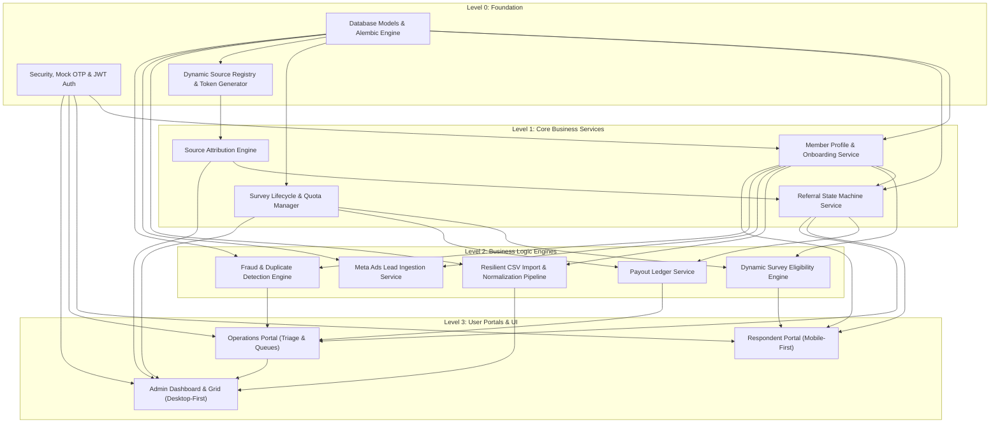

# ViewBox Club — System Requirements & Business Specifications
**Concave Insights — Technical Assessment: Full Stack Developer (Python/React)**

---

## 1. Executive Summary & Business Context

### 1.1 Company Background
**Concave Insights** is a market research and consumer intelligence firm headquartered in Mumbai, India. The company helps major consumer brands understand customer behavior, product fit, and brand perception by conducting targeted, high-fidelity surveys and focus studies across diverse Indian demographics.

### 1.2 Current Operational Paradigm & Bottlenecks
Concave Insights currently recruits survey respondents through decentralized, informal channels:
- 50+ city-specific WhatsApp groups (e.g., Mumbai, Pune, Nagpur, Ahmedabad).
- Direct WhatsApp direct messages (DMs) from field staff (e.g., Agent 01, Agent 02).
- Social media organic posts across Instagram and Facebook.
- Corporate website landing pages.
- Peer-to-peer word-of-mouth referral links shared by existing members.
- Planned future paid Meta Ads (Instagram and Facebook Lead Generation campaigns).

Under the current manual workflow, respondents are tracked in disconnected spreadsheets. This introduces critical operational vulnerabilities:
1. **Loss of Source Attribution:** When WhatsApp group invite links and registration forms are forwarded from chat to chat, the originating channel is lost. Operations cannot quantify which acquisition channels yield high-retention, survey-completing respondents versus low-quality leads.
2. **Referral Dissatisfaction & Attrition:** Existing members refer friends and colleagues but have zero visibility into whether their referral registered, qualified, or completed the study. Because bonuses are paid only after quality-checked completion, referrers suspect withheld payouts and stop sharing.
3. **Operational Bottlenecks in Eligibility Checking:** Operations personnel manually cross-reference respondent ages, cities, genders, incomes, past participation dates (3-month cool-off), and quotas across spreadsheets. This manual triage causes delays, high error rates, duplicate payouts, and phone calls from anxious members.
4. **Data Inconsistency:** Ad-hoc manual data entry leads to inconsistent city names ("Bombay" vs "Mumbai"), varied date formats (`DD/MM/YYYY`, `YYYY-MM-DD`, `DD-MM-YY`), truncated phone numbers, and invalid calendar dates (e.g., Feb 31).

### 1.3 Core Mission of ViewBox Club
ViewBox Club is an integrated respondent management, survey eligibility orchestration, and attribution platform designed to:
- Dynamically track all member acquisition touchpoints via cryptographically secure, tokenized links.
- Automate deterministic survey eligibility checking with strict/flexible criteria, quota locking, and 3-month cool-off enforcement.
- Provide a transparent, mobile-first respondent portal with live status, masked referral tracking, and human-readable feedback.
- Equip operations and administrators with real-time analytics, searchable data grids, referral verification pipelines, resilient CSV imports, and automated lead ingestion endpoints.

---

## 2. User Roles & Permission Matrix (RBAC)

The platform enforces strict Role-Based Access Control (RBAC). A user identity (`User`) is strictly decoupled from the demographic respondent profile (`MemberProfile`).

```
                    ┌──────────────────────────────────────────────┐
                    │               User (Auth)                    │
                    │  - id, phone, role, is_active, created_at    │
                    └──────────────────────┬───────────────────────┘
                                           │
         ┌─────────────────────────────────┼─────────────────────────────────┐
         │                                 │                                 │
         ▼                                 ▼                                 ▼
   [ Respondent ]                   [ Operations ]                    [ Administrator ]
  - Self Profile Management        - Respondent Triage               - Full System Config
  - Live Survey Feed               - Referral Fit & Completion       - Dynamic Source CRUD
  - Eligibility Explanations       - Survey Application Approval     - Survey Lifecycle CRUD
  - Referral Dashboard             - Payout Authorization            - Bulk CSV Ingestion
  - Masked Referrals View          - Fraud Review Quarantine         - Global Analytics & BI
```

### 2.1 Role Definitions
1. **Respondent (Member):** Consumer participating in research studies. Access is restricted exclusively to their own profile, available surveys, their own application status, and their referred respondents (with sensitive phone numbers masked).
2. **Operations Specialist:** Internal staff managing respondent onboarding, manual verification, referral stage progression, completion audits, and payout review. Cannot alter survey configuration, manage acquisition sources, or modify system-wide settings.
3. **Administrator:** System administrator with complete control over survey lifecycle, eligibility rules, dynamic source generation, CSV bulk imports, system audit logs, and user role assignments.

### 2.2 Permissions Matrix

| Functional Capability | Respondent | Operations | Administrator | Security Policy |
|:---|:---:|:---:|:---:|:---|
| **Authenticate via Mock OTP** | ✅ | ✅ | ✅ | Rate-limited (5 attempts / min) |
| **View/Edit Own Profile** | ✅ | ❌ | ❌ | Row-level ownership check |
| **View Available Surveys & Eligibility** | ✅ | ❌ | ❌ | Member-specific evaluation |
| **Apply for Survey** | ✅ | ❌ | ❌ | Pre-condition: Eligibility == APPROVED |
| **View Own Referrals & Status** | ✅ | ❌ | ❌ | Masked phone display (`98XXXXXX21`) |
| **Search / Filter All Respondents** | ❌ | ✅ | ✅ | Debounced, paginated data grid |
| **View Respondent Personal Details** | ❌ | ✅ | ✅ | Audit-logged access |
| **Verify Referral: Lead → Fit** | ❌ | ✅ | ✅ | State-machine validation |
| **Verify Referral: Fit → Completed** | ❌ | ✅ | ✅ | Requires Survey Completion record |
| **Mark Referral as Failed** | ❌ | ✅ | ✅ | Mandatory `failure_reason` input |
| **Approve Survey Applications** | ❌ | ✅ | ✅ | Operations queue |
| **Review & Approve Payouts** | ❌ | ✅ | ✅ | Two-step payout ledger |
| **Quarantine / Review Fraud Flags** | ❌ | ✅ | ✅ | Non-destructive audit review |
| **Create / Edit Surveys & Rules** | ❌ | ❌ | ✅ | Admin only; 15-day lifespan rule |
| **Create / Deactivate Acquisition Sources** | ❌ | ❌ | ✅ | Dynamic database record |
| **Generate Trackable Source Links** | ❌ | ❌ | ✅ | Tokenized attribution URL |
| **Bulk CSV Import & Normalization** | ❌ | ❌ | ✅ | Preview, validation & atomic commit |
| **Export Data (CSV / XLSX)** | ❌ | ✅ | ✅ | Filtered dataset export |
| **View System Audit Logs & BI** | ❌ | ❌ | ✅ | System-wide observability |

---

## 3. Comprehensive Functional Requirements (FR)

### Module 1: Dynamic Acquisition Source & Attribution Engine (FR-01)
- **FR-01.1 Dynamic Source Registry:** Acquisition sources must be stored as dynamic database entities (`AcquisitionSource`), never hardcoded in source files. Admins can create new sources (e.g., "LinkedIn Campaign Q4", "Campus Ambassador - Pune") at runtime.
- **FR-01.2 Tokenized Source Links:** The platform must generate unique, non-guessable, cryptographically random attribution tokens for each source (e.g., `/join?source_token=src_a8f9b23c10`).
- **FR-01.3 Attribution Event Logging:** Visiting an attribution link must record an `AttributionEvent` containing timestamp, IP address, user-agent, and source ID.
- **FR-01.4 Attribution Persistence:** The attribution token must be stored in a signed HTTP-only cookie / local storage to persist across navigation and onboarding.
- **FR-01.5 Fallback Organic Acquisition:** If a visitor registers without an attribution token, the registration workflow must present an intuitive dropdown: *"How did you hear about us?"* populated dynamically from active sources.
- **FR-01.6 Source Performance Aggregation:** The engine must aggregate real-time metrics per source:
  $$\text{Conversion Rate (Lead to Completed)} = \frac{\text{Completed Count}}{\text{Total Signups}} \times 100$$

### Module 2: Respondent Mobile-First Portal (FR-02)
- **FR-02.1 Passwordless Mock OTP Login:**
  - Phone number input with Indian mobile validation (10 digits).
  - Mock OTP generated server-side. In development mode, the OTP is returned in the API response and displayed on-screen for 1-click verification.
  - Generates secure JWT token pair (`access_token` with 15-minute expiry, `refresh_token` with 7-day expiry).
- **FR-02.2 Mandatory Onboarding Workflow:** New members must complete their profile before accessing the portal: Full Name, Date of Birth (validated $\ge 13$ years old), Gender (Male, Female, Non-binary/Other), City (normalized selection), Income Bracket, and categorized Interests (multi-select).
- **FR-02.3 Dynamic Respondent Dashboard:**
  - Profile completion indicator.
  - Active surveys feed with interest-match badges.
  - Live eligibility status badge per survey (`APPROVED`, `WAITLISTED`, `REJECTED`).
  - Active survey applications and recent participation history.
  - Personalized referral stats: Total Invited, Leads, In-Review (Fit), Completed, Earned Incentives.
  - 1-Click Copy Personal Referral Link.
- **FR-02.4 Survey Eligibility Explanation:** Transparent human-readable breakdown for every survey:
  - *Approved:* "You meet all eligibility criteria for this research study."
  - *Waitlisted:* "Your income bracket does not match the primary target. You have been waitlisted."
  - *Rejected:* "Not eligible: Age 17 does not meet the required range (18 to 35)."
  - *Cool-off:* "In cool-off: Eligible for next survey on 12-Feb-2027."
- **FR-02.5 Masked Referral Tracking ("My Referrals"):**
  - Displays list of referred individuals.
  - Privacy masking: Phone numbers must display as `98XXXXXX21` (first 2 digits, 6 masked 'X' characters, last 2 digits). Full numbers must never be transmitted to the client.
  - Real-time stage badge (`Lead`, `Fit`, `Completed`, `Failed`).
  - Displays operational failure reason if marked `Failed`.
- **FR-02.6 Profile Management:** Allows respondents to view and update permitted fields (city, income, interests) while keeping audit history.

### Module 3: Survey Lifecycle & Dynamic Eligibility Engine (FR-03)
- **FR-03.1 Strict 15-Day Project Lifecycle:** Every survey project must be bounded by a 15-day lifecycle:
  $$\text{Deadline} \le \text{Start Date} + 15\text{ days}$$
  Surveys past their deadline automatically transition to `EXPIRED` status and reject incoming applications.
- **FR-03.2 Survey Quota Enforcement & Concurrency Control:**
  - Survey defines `target_quota` and tracks `completed_count`.
  - When `completed_count >= target_quota`, survey status updates to `QUOTA_REACHED` and rejects further applicants.
  - Database transactions with `SELECT FOR UPDATE` (or atomic increment with check constraint) to prevent race conditions during concurrent applications.
- **FR-03.3 3-Month Cool-off Rule:**
  - A respondent who has completed a survey cannot participate in another study for 3 calendar months.
  - Evaluation uses verified `SurveyParticipation` completion date.
  - Calculation must handle month-end clamping (e.g., Nov 30 + 3 months $\rightarrow$ Feb 28/29) and leap years.
- **FR-03.4 Deterministic Multi-Rule Evaluation Engine:**
  - Rules evaluated across 5 dimensions: Age, City, Gender, Income Bracket, Interests.
  - Each rule is flagged as `STRICT` or `FLEXIBLE`.
  - Deterministic status precedence:
    $$\text{REJECTED} \succ \text{WAITLISTED} \succ \text{APPROVED}$$
  - A strict failure immediately triggers `REJECTED`.
  - A flexible failure triggers `WAITLISTED` (unless a strict failure already caused `REJECTED`).
  - Quota exhaustion, survey expiration, or active cool-off trigger immediate `REJECTED`.

### Module 4: Referral Workflow & Operations Portal (FR-04)
- **FR-04.1 Three-Stage State Machine:**
  ```
               [ 1. Lead ] (Registered via Member Referral Link)
                    │
            ┌───────┴───────┐
            ▼               ▼
        [ 2. Fit ]      [ Failed ] (Ops records reason: e.g. "Outside Target City")
            │
            ┌───────┴───────┐
            ▼               ▼
      [ 3. Completed ]  [ Failed ] (Ops records reason: e.g. "Failed Attention Check")
  ```
- **FR-04.2 Operational Transitions:**
  - `Lead` $\rightarrow$ `Fit`: Operations confirms respondent profile matches research requirements.
  - `Lead` $\rightarrow$ `Failed`: Disqualified before survey assignment. Reason required.
  - `Fit` $\rightarrow$ `Completed`: Operations confirms survey completion and passes quality checks.
  - `Fit` $\rightarrow$ `Failed`: Disqualified during or post-survey (e.g., fraudulent answers, speeders).
- **FR-04.3 Bonus Eligibility Trigger:** Referral bonus is awarded **only** when stage transitions to `Completed`. Registration alone never earns incentives.
- **FR-04.4 Operations Task Queues:**
  - Respondent Verification Queue.
  - Survey Application Triage Queue.
  - Referral Quality Review Queue.
  - Payout Authorization Queue.

### Module 5: Admin Panel, Data Grid & BI Analytics (FR-05)
- **FR-05.1 Executive KPI Dashboard:** Real-time metrics computed directly from database records:
  - Total Registered Respondents, New Signups (Last 7 Days), Active Surveys.
  - Funnel breakdown: Approved vs Waitlisted vs Rejected.
  - Completed Survey Participations & Verified Referral Conversions.
  - Visual charts: Signup Timeline, Source Distribution (Pie/Bar), Referral Conversion Funnel.
- **FR-05.2 Live Searchable & Filterable Data Grid:**
  - Real-time debounced search (300ms) across `name`, `member_id`, `city`, `phone`.
  - Multi-select filters: Source, City, Status, Gender, Income Bracket.
  - Server-side sorting and pagination (limit/offset).
- **FR-05.3 Contextual Data Export:** Export the **currently filtered/searched dataset** (not the raw database table) to both `.csv` and `.xlsx` (Excel) formats with proper MIME headers and timestamps.
- **FR-05.4 Survey Management Interface:**
  - Create/edit surveys with start date, deadline (max 15 days), target quota, incentives.
  - Configure multi-attribute eligibility rules with Strict/Flexible toggles.
  - View real-time participation progress and applicant logs.

### Module 6: Resilient CSV Import Pipeline (FR-06)
- **FR-06.1 11-Step Ingestion Pipeline:**
  1. Upload CSV file (`multipart/form-data`) with size ($\le 10\text{MB}$) and MIME validation.
  2. Inspect headers against expected schema.
  3. Safe line-by-line parsing resilient to unescaped commas and empty lines.
  4. Demographic & categorical normalization (Gender, City, Source, Income).
  5. Multi-criteria duplicate detection (Member ID, Normalized Phone).
  6. Mandatory field validation (Name, Phone, DOB, Gender).
  7. Interactive Import Preview generation.
  8. Categorized Error & Proposed Fixes report.
  9. Administrative confirmation step.
  10. Atomic database transaction commit.
  11. Downloadable Import Audit Report (CSV).
- **FR-06.2 Normalization Rules:**
  - *Gender:* `M`, `male`, `Male` $\rightarrow$ `Male`; `F`, `female`, `Female` $\rightarrow$ `Female`.
  - *City:* Trim whitespace, capitalize title case. Map `Bombay` $\rightarrow$ `Mumbai`; `Bangalore` $\rightarrow$ `Bengaluru`; `NaviMumbai`, `navi mumbai` $\rightarrow$ `Navi Mumbai`.
  - *Source:* `insta`, `IG`, `Instagram` $\rightarrow$ `Instagram`; `FB`, `Facebook` $\rightarrow$ `Facebook`; `website` $\rightarrow$ `Website`; `whatsapp mumbai`, `WA grp mumbai` $\rightarrow$ `WhatsApp Group - Mumbai`.
  - *Income:* Standardize to `Below 3L`, `3L-6L`, `6L-10L`, `10L-20L`, `Above 20L`. Flag ambiguous values (e.g. `5 lakh`) for administrative review.
  - *Dates:* Support formats `%Y-%m-%d`, `%d/%m/%Y`, `%d-%m-%Y`, `%d-%m-%y`. Reject impossible dates (e.g., `31/02/1995`).
  - *Phone Numbers:* Strip non-numeric characters, strip leading `+91` or `0` prefix, ensure exactly 10 digits. Reject truncated (<10) or malformed numbers.
- **FR-06.3 Non-Destructive Duplicate Policy:** Existing database records are skipped and flagged in the import report; records are never silently overwritten.

### Module 7: Meta Ads Lead Ingestion API (FR-07)
- **FR-07.1 Mock Leadgen Webhook Endpoint:** `POST /api/v1/integrations/meta/leads`.
- **FR-07.2 Payload Contract Specification:**
  ```json
  {
    "leadgen_id": "META_LEAD_984729103",
    "form_id": "FORM_AUTO_SURVEY_2026",
    "campaign_id": "CAMPAIGN_MUMBAI_YOUTH_01",
    "ad_id": "AD_CAROUSEL_V1",
    "created_time": "2026-11-24T10:00:00Z",
    "field_data": [
      {"name": "full_name", "values": ["Aarav Sharma"]},
      {"name": "phone_number", "values": ["+919876543210"]},
      {"name": "city", "values": ["Mumbai"]},
      {"name": "date_of_birth", "values": ["1998-05-15"]},
      {"name": "gender", "values": ["Male"]}
    ]
  }
  ```
- **FR-07.3 Lead Processing Logic:**
  - Validates mandatory fields (full name, valid phone number).
  - Normalizes phone number to 10 digits.
  - Automatically associates acquisition source with dynamic source `Meta Ads`.
  - Persists external `leadgen_id`, `campaign_id`, `form_id`, and `ad_id`.
  - Enforces unique constraint on `leadgen_id` to guarantee idempotent ingestion.
  - If identical phone already exists with different `leadgen_id`, flags as potential duplicate lead.

### Module 8 (Bonus): Fraud & Duplicate Detection Engine (FR-08)
- **FR-08.1 Automated Fraud Flagging:**
  - Duplicate Phone: Repeated signup attempts with existing phone number.
  - Self-Referral: Member entering their own referral code/link.
  - Referral Rings: Mutual referral loops ($A \rightarrow B$ and $B \rightarrow A$).
  - IP/Device Velocity Burst: $>3$ signups from same IP within 15 minutes.
- **FR-08.2 Quarantine Review Queue:** Flagged accounts are quarantined into a dedicated review queue. Accounts are **never automatically deleted**; human operational review is required.

### Module 9 (Bonus): Payout Ledger & Incentive Management (FR-09)
- **FR-09.1 Ledger Record Creation:** Automatically creates a pending `Payout` entry upon:
  1. Survey completion verified by operations (e.g., ₹250).
  2. Referral completion verified by operations (e.g., ₹100).
- **FR-09.2 Two-Stage Payout Workflow:**
  $$\text{Pending Approval} \xrightarrow{\text{Ops Review}} \text{Approved} \xrightarrow{\text{Disbursement}} \text{Paid} \quad (\text{or } \text{Failed})$$
- **FR-09.3 Payment Gateway Integration Blueprint:** RazorpayX / Cashfree Payouts sandbox blueprint with webhook reconciliation.

---

## 4. Non-Functional Requirements (NFR)

- **NFR-01 Performance & Latency:** API response times $\le 200\text{ms}$ for standard CRUD operations. Respondent grid search debounced to 300ms with fast index-assisted queries.
- **NFR-02 Data Integrity & Atomicity:** ACID transaction guarantees across survey quota updates, referral status progressions, and CSV import commits.
- **NFR-03 Security & Privacy:**
  - Role-based token claims in JWT.
  - Phone masking in all respondent-facing interfaces (`98XXXXXX21`).
  - Protection against SQL injection via SQLAlchemy ORM parameter binding.
  - Rate limiting on authentication and webhook endpoints (SlowAPI).
- **NFR-04 Usability & Accessibility:**
  - Mobile-first responsive design for Respondent Portal ($360\text{px}$ to $430\text{px}$ optimized).
  - High information density for Admin & Operations desktop dashboards ($1280\text{px}+$ optimized).
  - Semantic HTML, WCAG AA contrast standards, clear visual loading/empty/error states.
- **NFR-05 Reliability & Fault Tolerance:**
  - CSV parser handles corrupt, empty, and malformed rows gracefully without process termination.
  - Structured JSON logging with request tracing IDs.
- **NFR-06 Maintainability & Separation of Concerns:**
  - Strict layered architecture: Controller $\rightarrow$ Service $\rightarrow$ Repository $\rightarrow$ Database Model.
  - Zero duplication of eligibility or business logic on frontend.
  - TypeScript strict typing matching backend Pydantic schemas.

---

## 5. Feature Dependency Map (DAG)



---

## 6. Analysis of Edge Cases, Inconsistencies & Business Decisions

Based on thorough structural analysis of `viewbox_respondents_sample.csv` (189 rows) and assessment specifications, the following edge cases and business ambiguities have been documented and resolved:

### 6.1 Decision 1: Source Conflict Resolution (Source vs Referrer)
- **Scenario:** A respondent clicks an Instagram acquisition link (`source = Instagram`) but during registration enters a valid member referral code (`referred_by = VB10014`).
- **Architectural Decision:** **Preserve both dimensions independently.**
  - `MemberProfile.acquisition_source_id` is set to `Instagram`.
  - `Referral` record is created linking referrer `VB10014` to the new member.
- **Justification:** Acquisition channel and peer-to-peer referral are orthogonal business dimensions. Overwriting one with the other destroys channel ROI reporting and disenfranchises the referring member.

### 6.2 Decision 2: First-Touch vs Last-Touch Attribution
- **Scenario:** A user visits a WhatsApp group link on Day 1, does not register, then clicks an Instagram ad link on Day 7 and registers.
- **Architectural Decision:** **First-touch is primary acquisition source; all touches recorded as attribution events.**
  - `MemberProfile.acquisition_source_id` records `WhatsApp Group` (First-Touch).
  - An `AttributionEvent` is logged for both the WhatsApp visit and the subsequent Instagram click.
- **Justification:** In consumer research panels, initial awareness determines channel acquisition economics. Secondary touches illustrate multi-channel nurture.

### 6.3 Decision 3: 3-Month Cool-off Date Arithmetic
- **Scenario:** Member completed survey on November 30, 2026. What is the next eligible date?
- **Decision:** Next eligible date is March 1, 2027 (clamped to calendar month boundary: Nov 30 + 3 calendar months $\rightarrow$ Feb 28 in non-leap year + 1 day).
- **Rule:** Calculated using Python `dateutil.relativedelta(months=+3)` to ensure leap-year safety and month-end correctness.

### 6.4 Decision 4: Concurrency & Survey Quota Race Conditions
- **Scenario:** 5 respondents simultaneously submit an application for the final available survey quota slot.
- **Decision:** Quota decrement and application creation are executed inside an atomic database transaction with row-level lock (`SELECT FOR UPDATE` or conditional update: `UPDATE surveys SET completed_count = completed_count + 1 WHERE id = :id AND completed_count < target_quota`). Excess attempts receive `REJECTED: Quota exhausted`.

### 6.5 Decision 5: Messy CSV Anomalies & Ingestion Policies
From the sample CSV analysis:
1. **Empty Lines (Row 26):** Skipped automatically without error.
2. **Missing Mandatory Fields (Row 33 missing member_id; Row 98 missing name; Row 45 missing phone):** Quarantined as unimportable; logged with specific column error.
3. **Invalid Dates (Row 15: `31/02/1995`):** Flagged as impossible date; row rejected.
4. **Self-Referrals (Row 48: `VB10014` referred by `VB10014`):** Normalized; member imported, self-referral discarded and flagged for fraud audit.
5. **Duplicate Member IDs & Phones (Row 26 & 104 `VB10011`; Row 3 & 7 `9958519043`):** First occurrence imported; subsequent duplicates skipped with conflict notification.
6. **Ambiguous Income (Row 8: `5 lakh`):** Flagged for review; mapped to bracket `3L-6L` upon admin confirmation.
7. **City Aliases (`Bombay`, `Bangalore`, `NaviMumbai`):** Automatically normalized to canonical cities (`Mumbai`, `Bengaluru`, `Navi Mumbai`).
8. **Survey Completion Date prior to Join Date (Row 79):** Logged as data anomaly for ops review; historical record preserved with flag.
